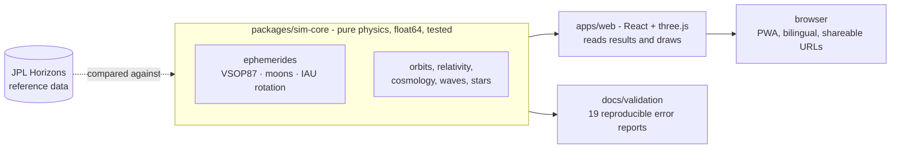

<div align="center">


# USAC SimLab

### The virtual astronomy laboratory

**As intuitive as a game, grounded in solid science.**<br>
From the motion of the Sun to mysterious black holes, every simulation lets you explore the universe through data, physical equations and clearly stated limits.

[**Try it online**](https://usac-simlab.clbtvusac.com/) · [3D Solar System](https://usac-simlab.clbtvusac.com/#/m/e1) · [Tiếng Việt](README.md) · [Validation reports](docs/validation)


[](https://github.com/minhtali-usac/USAC-SIMLAB/actions/workflows/ci.yml)


</div>

---

## What is USAC SimLab

USAC SimLab is the open web platform of the **USAC Astronomy Club** for learning astronomy and astrophysics through interactive simulation. Everything runs in the browser: no login, no installation, works offline and on phones.

What sets it apart is that we **do not merely illustrate**. Each simulation is built on real data and cited equations, compared against independent references such as JPL Horizons, and **publishes its measured error** in the interface. Anything that is only an illustration is labelled as one.

<table>
<tr>
<td width="25%" valign="top">

**🎮 Intuitive**<br>
Drag, rotate, change parameters and see the result at once. Every module has a lesson, "Try it" activities and quiz questions.

</td>
<td width="25%" valign="top">

**📐 Accurate**<br>
Physics runs in 64-bit floats in a dedicated core with 288 tests against analytic solutions, conservation laws and reference data.

</td>
<td width="25%" valign="top">

**🔍 Transparent**<br>
19 validation reports reproducible with one command. Each module's Model Card states equations, assumptions, validity range, error and limits.

</td>
<td width="25%" valign="top">

**🌏 Open**<br>
Bilingual Vietnamese and English. Free software under the GNU GPL; simulation state lives in the URL, so a link shares exactly what you see.

</td>
</tr>
</table>

## At a glance

<table>
<tr>
<td width="50%"><br><sub><b>E1 · 3D Solar System.</b> Saturn near the ring-opening maximum (15 Sep 2017): the planet's shadow falls on the rings, the hexagon sits at the north pole.</sub></td>
<td width="50%"><br><sub><b>E1 · Earth.</b> Cloud layer, scattering atmosphere rim, a soft terminator and city lights on the night side.</sub></td>
</tr>
<tr>
<td width="50%"><br><sub><b>D3 · Schwarzschild black hole.</b> GPU ray tracing in real time; the shadow edge agrees with Synge's analytic formula to within 0.003%.</sub></td>
<td width="50%"><br><sub><b>B2 · Transfer to Mars.</b> Hohmann, ephemeris-based phase angles and the Lambert problem with a porkchop plot.</sub></td>
</tr>
<tr>
<td width="50%"><br><sub><b>A3 · Phases of the Moon.</b> Three synchronised views on a real date; major-phase times agree with JPL Horizons to within 0.3 minutes.</sub></td>
<td width="50%"><br><sub><b>Home.</b> 21 simulations in six groups, three levels: Explore, Learn, Advanced.</sub></td>
</tr>
</table>

## Spotlight: the 3D Solar System (E1)

Module E1 has been rebuilt. It integrates components of [Celestia](https://celestiaproject.space), the well-known open-source space simulator, then **customises, localises and re-measures their accuracy** for this platform.

| | Before | Now |
|---|---|---|
| **Planets** | Approximate Kepler elements, errors up to 9′ | **VSOP87** series, error **≤ 1.2″** (Uranus 2.2″, Neptune 4.4″) over 1800–2200 |
| **Moons** | None | **17 moons**: the Moon (max error **38 km**), the four Galilean moons, seven moons of Saturn, four of Uranus, and Triton |
| **Spin axes** | Mean obliquity | **IAU pole and prime-meridian models** per body; tilts agree with NASA's table to 0.6° |
| **Rendering** | Lambert lighting | Celestia's lighting model, solar and lunar eclipse shadows, ring shadows, scattering atmosphere, city lights, PSF stars, fading orbits |
| **Time** | Daily steps | Hourly steps, reverse time, from 1 minute/s to 10 years/s, ±3000 years |

Shadows are computed in **real kilometres** per pixel, so they fall in the right place even when the picture is exaggerated. The full chain (VSOP87, lunar theory, Earth rotation, shadow geometry) was tested against two real eclipses: the darkest point of the **8 Apr 2024** total eclipse lies less than 1° from NASA's point of greatest eclipse, and the **14 Oct 2023** annular eclipse leaves 9.2% of the light, against 9.4% predicted from the diameter ratio.

One detail shows how we work: while measuring, we found that VSOP87's "Earth" series gives the **geocentre**, not the Earth-Moon barycentre (a 6.9″ offset, about 4,700 km), so we corrected it and recorded it in the Model Card. We also **left out** moons whose available theory is not good enough (Phobos and Deimos are off by 4–22°, Miranda by 9°, Hyperion by 1.8°) rather than draw them as if they were accurate. All measured errors are in [docs/validation/E1-vsop87.json](docs/validation/E1-vsop87.json) and [E1-moons.json](docs/validation/E1-moons.json).

## The simulations

Six groups, 21 simulations. Level **A** is a validated quantitative model, **B** a simplified model with stated scope, **C** an illustration (USAC SimLab's internal labels).

| Code | Simulation | Level | Highlights |
|---|---|---|---|
| A1 | Motion of the Sun | A | 3D celestial sphere at the real place and time; Sun within 34″ and rise/set times within 0.1 min of JPL Horizons; analemma, real bright stars |
| A3 | Phases of the Moon | A | Three synchronised views on a real date, upcoming phases computed from the date being viewed, major-phase times within 0.3 min |
| A4 | Exoplanet hunting | A | Radial velocity and limb-darkened transits, noise, SNR |
| A5 | Variable stars | B | Weighted GLS periodogram, bootstrap FAP, alias warnings, Leavitt law and extinction (δ Cep 265 ± 5 pc vs 273 ± 11 pc) |
| A6 | Habitable zone | A | Four Kopparapu 2014 boundaries, equilibrium temperature with Bond albedo, host stars from the NASA Exoplanet Archive |
| B1 | Kepler orbits and the two-body problem | A | Ellipse, parabola, hyperbola; equal areas in equal times to ≤ 4 × 10⁻¹¹; SBDB periods reproduced to 2 × 10⁻¹⁰ |
| B2 | Orbit transfer and the way to Mars | A | Hohmann, ephemeris phase angles, Lambert (v∞, C₃, porkchop); bi-elliptic thresholds 11.94 and 15.58 computed numerically |
| B3 | Circular restricted three-body problem | B | Lagrange points (residual ≤ 10⁻¹⁵), Jacobi level, linear stability, DOPRI5 vs independent RK4 convergence check |
| B4 | N-body sandbox | B | Leapfrog, 4th-order Yoshida, RK4, energy drift |
| C1 | Light clock and muons | A | Time dilation seen from two frames |
| C2 | Minkowski diagram | A | Drag events, change frames by rapidity, the twin paradox |
| C4 | Flying near light speed | A | Aberration and Doppler shift on a real star sky |
| D1 | Gravitational time and GPS | A | Clocks on the geoid: +38.58 μs/day, matching Ashby (2003); Pound-Rebka |
| D2 | Schwarzschild vs Newton | B | float64 geodesics, effective potential, ISCO, 43″/century |
| D3 | Schwarzschild black hole | B | Real-time GPU ray tracing, Doppler disc, two clocks during infall |
| D5 | Gravitational lensing | A | Backward ray tracing, Einstein ring, microlensing |
| D8 | FLRW cosmology | B | Planck 2018: age 13.79 Gyr, a(t), distance measures |
| **E1** | **3D Solar System** | **A** | **VSOP87, 17 moons, IAU spin axes, Celestia-style light and shadow (see above)** |
| F1 | 3D electromagnetic waves | A | Linear, circular, elliptical polarisation via Jones vectors; full spectrum from 1 pm to 1 km; real sources (21 cm, Hα, Cu Kα, 511 keV) |
| F2 | Sound and light | A | Speed of sound by gas and temperature, light as c/n, real-time lightning-thunder race |
| F3 | The speed of light: a real journey | A | A light ray to the Moon, planets, Proxima, the Galactic centre, Andromeda, at today's distances |

Every simulation has **three levels** (Explore, Learn, Advanced), a **Model Card** (ⓘ button), a **lesson** with KaTeX, link sharing (for example `#/m/e1?sel=jupiter&date=2026-10-22`), screenshots, full screen and the shortcuts `Space`, `R`, `L`, `I`.

## How it is built, and why you can trust it



- **Physics lives only in `packages/sim-core`**: pure functions, 64-bit floats, runnable on Node, independent of the UI. GPU shaders only draw; they are never the source of a displayed number.
- **Every constant and formula carries a citation.** Where we are unsure, the code says `TODO: cần xác minh` ("needs verification") instead of guessing.
- **Independent validation** against JPL Horizons, analytic solutions and conservation laws. Run `npm run validate` to regenerate every report; the figures in the Model Cards come from these reports.
- **Fidelity is never blurred**: an illustration (level C) is never presented as an accurate model.
- **All parameters live in the URL**, so a link restores the exact state.

```
packages/sim-core/   Pure physics with tests and validation scripts
  src/ephemeris      VSOP87, moons, IAU rotation, Solar System state (E1)
  src/celestial      Sun, Moon, Kepler planets, eclipses, coordinates
  src/orbits         Kepler, Hohmann, Lambert, CR3BP, N-body
  src/relativity-*   Special and general relativity, lensing, GPS
  src/cosmology      Friedmann, distances, supernovae
  test/              288 tests and reference data (test/fixtures)
apps/web/            Vite + React + TypeScript + three.js (React Three Fiber)
  src/modules/<id>/  One folder per simulation, lazy-loaded
reference/           Scripts that fetch Horizons data and port code from Celestia
docs/                BRIEF.md (vision), AGENTS.md (conventions), validation/ (error reports)
```

## Run it on your machine

Requires Node.js 24 (the version CI uses).

```bash
npm install
npm run dev          # opens http://localhost:5173
npm test             # 339 tests (288 physics + 51 interface)
npm run typecheck    # strict TypeScript for the core and the web app
npm run build        # static site in apps/web/dist, deployable to any static host
npm run validate     # regenerate every validation report in docs/validation
npm run validate:e1  # only the 3D Solar System report (VSOP87 and moons)
```

The reference data used for comparison is fetched with the scripts in `reference/`, for example `node reference/fetch_horizons_moons.mjs packages/sim-core/test/fixtures`. The site deploys itself to GitHub Pages through [GitHub Actions](.github/workflows/deploy.yml).

## Contributing

Read [docs/AGENTS.md](docs/AGENTS.md) before changing code. Three things to remember:

1. Write physics in `sim-core` with tests and citations; the UI only draws.
2. Every user-facing string needs both Vietnamese and English, and every simulation parameter must live in the URL.
3. Run `npm test` and `npm run typecheck` before submitting.

A module counts as done only when it meets the criteria in section 4 of AGENTS.md, including a complete Model Card and an A/B/C label. The product vision is in [docs/BRIEF.md](docs/BRIEF.md).

## Licence and credits

**USAC SimLab is free software under the GNU GPL, version 2 or (at your option) any later version** ([LICENSE](LICENSE)). Module E1 contains code derived from **[Celestia](https://celestiaproject.space)** (Copyright (C) 2001-present, the Celestia Development Team, also GPL v2 or later): the VSOP87 tables, satellite theories, IAU rotation models and lighting approach were ported to TypeScript and GLSL, customised and re-validated. The list of derived files, the changes and their dates is in [NOTICE.md](NOTICE.md).

Some components keep their own licences, listed in [CREDITS.md](CREDITS.md): planetary textures from Solar System Scope (CC BY 4.0, based on NASA data), the ESO Milky Way panorama (CC BY 4.0), module-card images from Wikimedia Commons, and fonts under the SIL OFL.

The pedagogical structure is inspired by **NAAP** (Nebraska Astronomy Applet Project, University of Nebraska-Lincoln); the project copies no NAAP code, images or text. Modules F1 to F3 were developed from the [lss-lab](https://github.com/MinhMPA/lss-lab) toolkit by Dr. Nguyen Nhat Minh (ICISE Quy Nhon; Kavli IPMU, University of Tokyo).

## Contact

USAC Astronomy Club · [clb.usac@gmail.com](mailto:clb.usac@gmail.com) · [Facebook page](https://www.facebook.com/clbusac)

<sub>This program is distributed in the hope that it will be useful, but without any warranty. See the GNU GPL for details.</sub>
