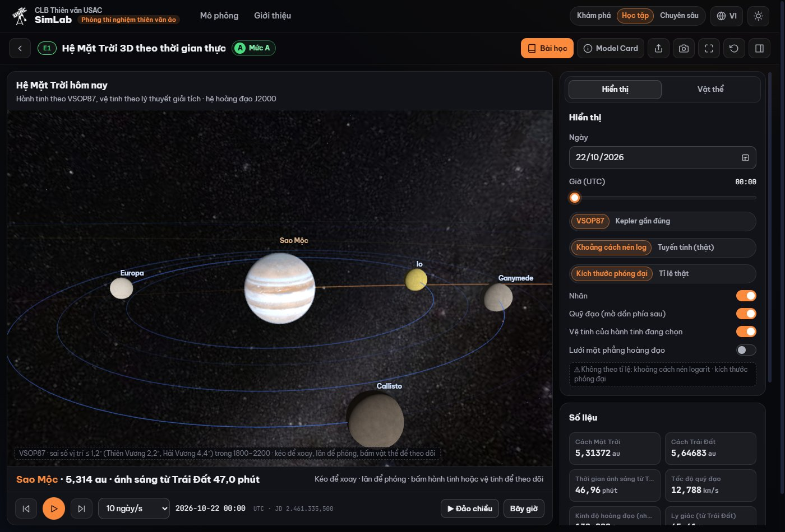
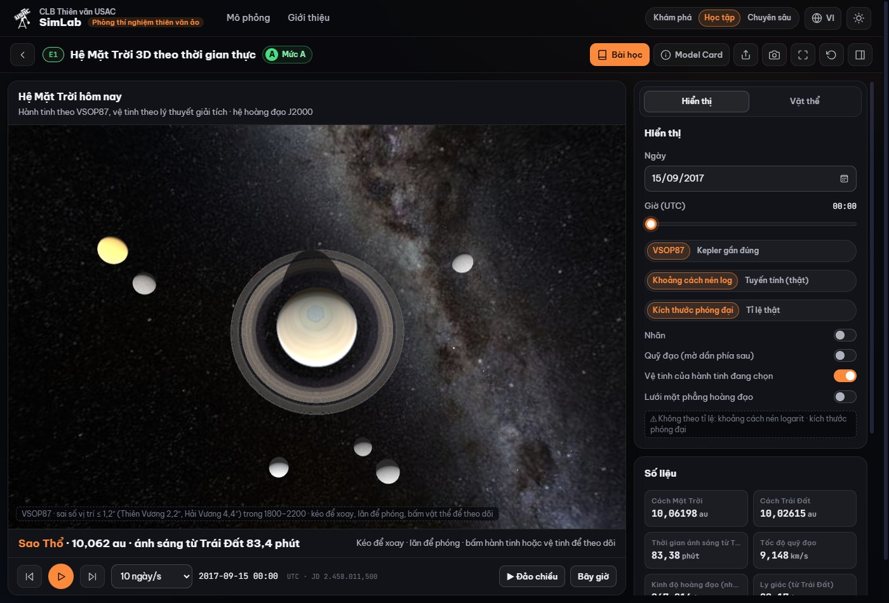
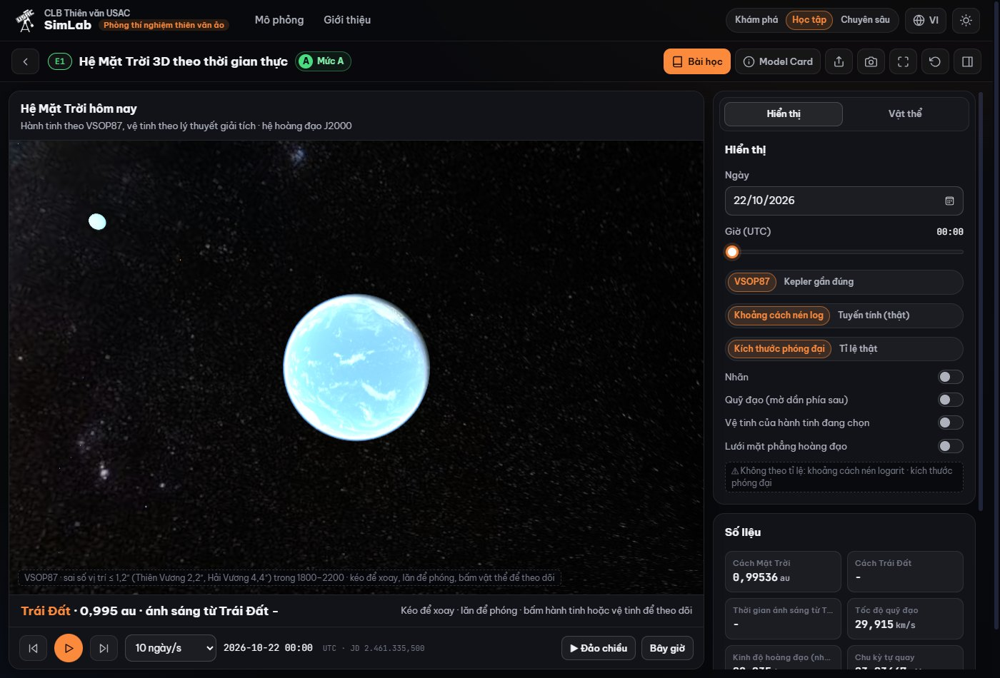
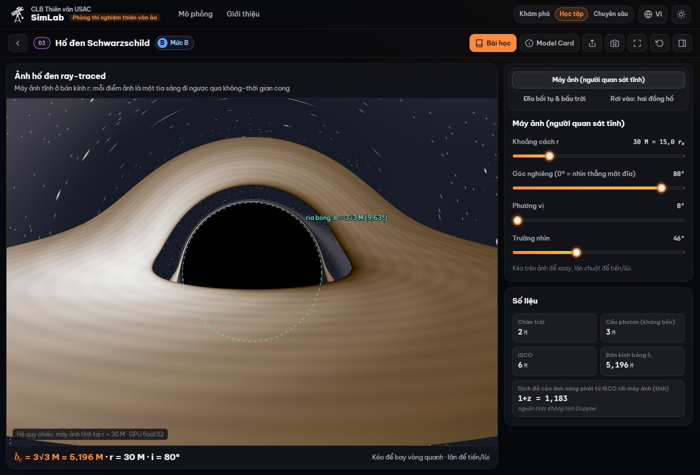
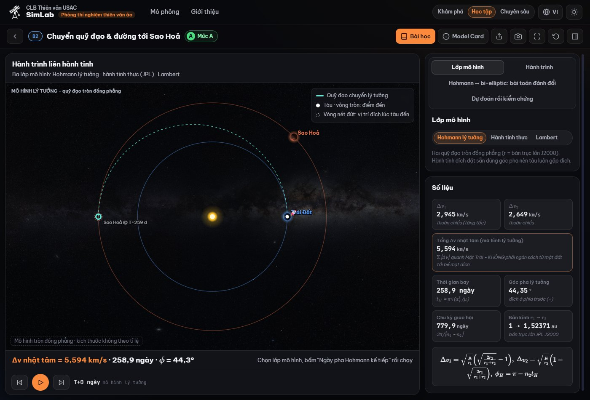
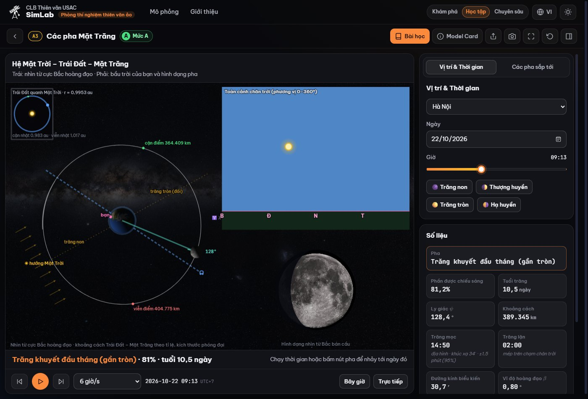
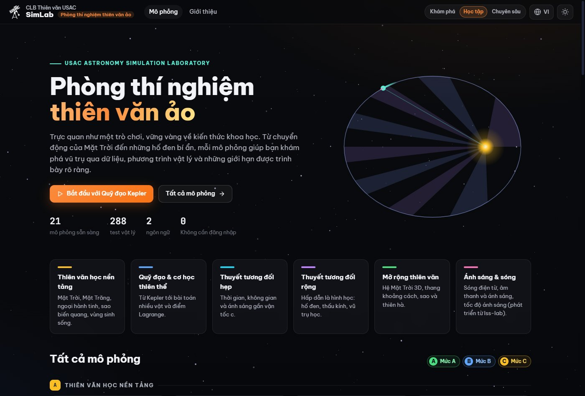
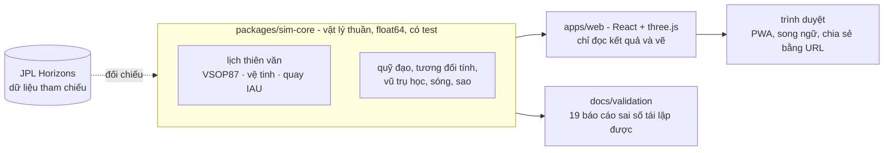

<div align="center">



# USAC SimLab

### Phòng thí nghiệm thiên văn ảo

**Trực quan như một trò chơi, vững vàng về kiến thức khoa học.**<br>
Từ chuyển động của Mặt Trời đến những hố đen bí ẩn, mỗi mô phỏng giúp bạn khám phá vũ trụ qua dữ liệu, phương trình vật lý và những giới hạn được trình bày rõ ràng.

[**Dùng thử trực tuyến**](https://usac-simlab.clbtvusac.com/) · [Hệ Mặt Trời 3D](https://usac-simlab.clbtvusac.com/#/m/e1) · [Tiếng Anh](README.en.md) · [Báo cáo kiểm chứng](docs/validation)


[](https://github.com/minhtali-usac/USAC-SIMLAB/actions/workflows/ci.yml)



</div>

---

## USAC SimLab là gì

USAC SimLab là nền tảng web mở của **CLB Thiên văn USAC** để học thiên văn học và vật lý thiên thể qua mô phỏng tương tác. Mọi thứ chạy ngay trong trình duyệt: không cần đăng nhập, không cần cài đặt, dùng được ngoại tuyến và trên điện thoại.

Điểm khác biệt là chúng tôi **không chỉ minh hoạ**. Mỗi mô phỏng được xây trên dữ liệu thật và phương trình có trích dẫn, so với nguồn tham chiếu độc lập như JPL Horizons, và **công bố sai số đo được** ngay trong giao diện. Nếu một phần chỉ mang tính minh hoạ, nó được gắn nhãn là minh hoạ.

<table>
<tr>
<td width="25%" valign="top">

**🎮 Trực quan**<br>
Kéo, xoay, đổi tham số và thấy kết quả ngay. Mỗi mô-đun có bài học, hoạt động "Hãy thử" và câu hỏi kiểm tra.

</td>
<td width="25%" valign="top">

**📐 Chính xác**<br>
Vật lý chạy bằng số thực 64 bit trong một lõi riêng, có 288 phép kiểm thử đối chiếu nghiệm giải tích, định luật bảo toàn và dữ liệu tham chiếu.

</td>
<td width="25%" valign="top">

**🔍 Minh bạch**<br>
19 báo cáo kiểm chứng tái lập bằng một lệnh. Model Card của từng mô-đun ghi phương trình, giả định, miền hợp lệ, sai số và giới hạn.

</td>
<td width="25%" valign="top">

**🌏 Mở**<br>
Song ngữ Việt - Anh. Mã nguồn tự do theo GNU GPL, trạng thái mô phỏng nằm trong URL nên chia sẻ được bằng liên kết.

</td>
</tr>
</table>

## Xem nhanh

<table>
<tr>
<td width="50%"><br><sub><b>E1 · Hệ Mặt Trời 3D.</b> Sao Thổ mùa vành đai mở rộng (15/9/2017): bóng của hành tinh đổ lên vành đai, lục giác ở cực bắc.</sub></td>
<td width="50%"><br><sub><b>E1 · Trái Đất.</b> Lớp mây, viền khí quyển tán xạ, vùng chạng vạng mềm và đèn thành phố bên phần đêm.</sub></td>
</tr>
<tr>
<td width="50%"><br><sub><b>D3 · Hố đen Schwarzschild.</b> Dò tia trên GPU theo thời gian thực; rìa bóng lệch không quá 0,003% so với công thức giải tích của Synge.</sub></td>
<td width="50%"><br><sub><b>B2 · Chuyển quỹ đạo tới Sao Hoả.</b> Hohmann, ngày pha theo lịch thiên văn và bài toán Lambert với bản đồ porkchop.</sub></td>
</tr>
<tr>
<td width="50%"><br><sub><b>A3 · Các pha Mặt Trăng.</b> Ba góc nhìn đồng bộ theo ngày thật; thời điểm các pha chính lệch không quá 0,3 phút so với JPL Horizons.</sub></td>
<td width="50%"><br><sub><b>Trang chủ.</b> 21 mô phỏng trong sáu nhóm, ba cấp độ Khám phá, Học tập, Chuyên sâu.</sub></td>
</tr>
</table>

## Nổi bật: Hệ Mặt Trời 3D (E1)

Mô-đun E1 vừa được xây lại, tích hợp các thành phần của [Celestia](https://celestiaproject.space), phần mềm mô phỏng không gian mã nguồn mở nổi tiếng, rồi **tuỳ biến, Việt hoá và đo lại độ chính xác** cho hệ thống này.

| | Trước | Bây giờ |
|---|---|---|
| **Hành tinh** | Phần tử Kepler gần đúng, sai số tới 9′ | Chuỗi **VSOP87**, sai số **≤ 1,2″** (Sao Thiên Vương 2,2″, Sao Hải Vương 4,4″) trong 1800–2200 |
| **Vệ tinh** | Không có | **17 vệ tinh**: Mặt Trăng (lệch tối đa **38 km**), bốn vệ tinh Galilê, bảy vệ tinh của Sao Thổ, bốn của Sao Thiên Vương và Triton |
| **Trục quay** | Độ nghiêng trung bình | **Cực quay và pha quay theo IAU** cho từng thiên thể; độ nghiêng khớp bảng NASA trong 0,6° |
| **Hình ảnh** | Chiếu sáng Lambert | Mô hình ánh sáng của Celestia, bóng nhật/nguyệt thực, bóng vành đai, khí quyển tán xạ, đèn thành phố, sao dạng PSF, quỹ đạo mờ dần |
| **Thời gian** | Theo ngày | Theo giờ, đảo chiều thời gian, từ 1 phút/giây đến 10 năm/giây, ±3000 năm |

Bóng được tính bằng **km thật** ở từng điểm ảnh nên rơi đúng chỗ dù hình vẽ phóng đại. Toàn bộ chuỗi tính (VSOP87, lý thuyết Mặt Trăng, quay của Trái Đất, hình học bóng) được thử với hai lần nhật thực có thật: điểm tối nhất của nhật thực toàn phần **8/4/2024** cách điểm cực đại của NASA chưa tới 1°, và nhật thực vành khuyên **14/10/2023** còn lại 9,2% ánh sáng, khớp 9,4% tính từ tỉ lệ đường kính.

Một chi tiết nhỏ cho thấy cách chúng tôi làm việc: khi đo, chúng tôi phát hiện chuỗi "Trái Đất" của VSOP87 cho **tâm Trái Đất** chứ không phải khối tâm Trái Đất-Mặt Trăng (lệch 6,9″, tương ứng 4 700 km), nên sửa lại và ghi vào Model Card. Chúng tôi cũng **không đưa vào** những vệ tinh mà lý thuyết có sẵn chưa đủ tốt (Phobos và Deimos lệch 4-22°, Miranda lệch 9°, Hyperion lệch 1,8°), thay vì vẽ chúng như thể chính xác. Mọi sai số đo được nằm trong [docs/validation/E1-vsop87.json](docs/validation/E1-vsop87.json) và [E1-moons.json](docs/validation/E1-moons.json).

## Các mô phỏng

Sáu nhóm, 21 mô phỏng. Mức **A** là mô hình định lượng đã kiểm chứng, mức **B** là mô hình đơn giản hoá có ghi rõ phạm vi, mức **C** là minh hoạ (nhãn nội bộ của USAC SimLab).

| Mã | Mô phỏng | Mức | Điểm nổi bật |
|---|---|---|---|
| A1 | Chuyển động của Mặt Trời | A | Thiên cầu 3D tại vị trí và giờ thật; Mặt Trời lệch ≤ 34″ và giờ mọc/lặn ≤ 0,1 phút so với JPL Horizons; analemma, sao sáng thật |
| A3 | Các pha Mặt Trăng | A | Ba góc nhìn đồng bộ theo ngày thật, các pha sắp tới tính từ thời điểm đang xem, giờ pha chính ≤ 0,3 phút |
| A4 | Săn ngoại hành tinh | A | Vận tốc xuyên tâm và quá cảnh có tối rìa, nhiễu đo, SNR |
| A5 | Sao biến quang | B | Chu đồ GLS có trọng số, FAP bootstrap, cảnh báo alias, Leavitt và hấp thụ (δ Cep 265 ± 5 pc so với 273 ± 11 pc) |
| A6 | Vùng sinh sống được | A | Bốn biên Kopparapu 2014, nhiệt độ cân bằng với suất phản chiếu Bond, hệ sao từ NASA Exoplanet Archive |
| B1 | Quỹ đạo Kepler và bài toán hai vật | A | Elip, parabol, hyperbol; múi diện tích bằng thời gian lệch ≤ 4 × 10⁻¹¹; chu kỳ SBDB tái lập tới 2 × 10⁻¹⁰ |
| B2 | Chuyển quỹ đạo và đường tới Sao Hoả | A | Hohmann, ngày pha theo lịch thiên văn, Lambert (v∞, C₃, porkchop); ngưỡng bi-elliptic 11,94 và 15,58 tính số |
| B3 | Bài toán ba vật hạn chế tròn | B | Điểm Lagrange (phần dư ≤ 10⁻¹⁵), mức Jacobi, ổn định tuyến tính, kiểm tra hội tụ DOPRI5 và RK4 độc lập |
| B4 | Sandbox N vật | B | Leapfrog, Yoshida bậc 4, RK4, độ trôi năng lượng |
| C1 | Đồng hồ ánh sáng và muon | A | Giãn thời gian nhìn từ hai hệ quy chiếu |
| C2 | Biểu đồ Minkowski | A | Kéo sự kiện, đổi hệ bằng rapidity, nghịch lý sinh đôi |
| C4 | Bay gần tốc độ ánh sáng | A | Quang sai và Doppler trên bầu trời sao thật |
| D1 | Thời gian hấp dẫn và GPS | A | Đồng hồ trên geoid: +38,58 μs/ngày, khớp Ashby (2003); Pound-Rebka |
| D2 | Schwarzschild và Newton | B | Đường trắc địa float64, thế hiệu dụng, ISCO, 43″/thế kỷ |
| D3 | Hố đen Schwarzschild | B | Dò tia GPU thời gian thực, đĩa Doppler, hai đồng hồ khi rơi vào |
| D5 | Thấu kính hấp dẫn | A | Dò tia ngược, vòng Einstein, microlensing |
| D8 | Vũ trụ học FLRW | B | Planck 2018: tuổi 13,79 tỉ năm, a(t), các loại khoảng cách |
| **E1** | **Hệ Mặt Trời 3D** | **A** | **VSOP87, 17 vệ tinh, trục quay IAU, ánh sáng và bóng kiểu Celestia (xem phần trên)** |
| F1 | Sóng điện từ 3D | A | Phân cực thẳng, tròn, elip theo vectơ Jones; toàn phổ 1 pm đến 1 km; nguồn thật (21 cm, Hα, Cu Kα, 511 keV) |
| F2 | Âm thanh và ánh sáng | A | Tốc độ âm theo khí và nhiệt độ, ánh sáng c/n, đua sét - sấm thời gian thực |
| F3 | Tốc độ ánh sáng: một chuyến đi thật | A | Tia sáng tới Mặt Trăng, hành tinh, Proxima, tâm Ngân Hà, Andromeda với khoảng cách hôm nay |

Mỗi mô phỏng đều có **ba cấp độ** (Khám phá, Học tập, Chuyên sâu), **Model Card** (nút ⓘ), **bài học** có KaTeX, chia sẻ bằng liên kết (ví dụ `#/m/e1?sel=jupiter&date=2026-10-22`), chụp ảnh, toàn màn hình và phím tắt `Space`, `R`, `L`, `I`.

## Cách tổ chức và vì sao tin được



- **Vật lý chỉ nằm trong `packages/sim-core`**: hàm thuần, số thực 64 bit, chạy được trên Node, không phụ thuộc giao diện. Shader GPU chỉ dùng để vẽ, không phải nguồn của con số hiển thị.
- **Mỗi hằng số và công thức đều kèm nguồn.** Chỗ nào chưa chắc, mã ghi `TODO: cần xác minh` thay vì đoán.
- **Kiểm chứng độc lập**: số liệu so với JPL Horizons, nghiệm giải tích, định luật bảo toàn. Chạy `npm run validate` để tạo lại toàn bộ báo cáo; các con số trong Model Card lấy từ chính những báo cáo này.
- **Không lẫn mức trung thực**: hình minh hoạ (mức C) không bao giờ được trình bày như mô hình chính xác.
- **Mọi tham số nằm trong URL**, nên một liên kết khôi phục đúng trạng thái.

```
packages/sim-core/   Vật lý thuần, có test và script kiểm chứng
  src/ephemeris      VSOP87, vệ tinh, quay IAU, trạng thái hệ Mặt Trời (E1)
  src/celestial      Mặt Trời, Mặt Trăng, hành tinh Kepler, nhật/nguyệt thực, toạ độ
  src/orbits         Kepler, Hohmann, Lambert, CR3BP, N vật
  src/relativity-*   Tương đối hẹp và rộng, thấu kính, GPS
  src/cosmology      Friedmann, khoảng cách, siêu tân tinh
  test/              288 test và dữ liệu tham chiếu (test/fixtures)
apps/web/            Vite + React + TypeScript + three.js (React Three Fiber)
  src/modules/<id>/  Mỗi mô phỏng là một thư mục, tải lười
reference/           Script lấy dữ liệu Horizons và chuyển mã từ Celestia
docs/                BRIEF.md (định hướng), AGENTS.md (quy ước), validation/ (báo cáo sai số)
```

## Chạy trên máy của bạn

Yêu cầu Node.js 24 (phiên bản CI dùng).

```bash
npm install
npm run dev          # mở http://localhost:5173
npm test             # 339 test (288 vật lý + 51 giao diện)
npm run typecheck    # TypeScript strict cho lõi và web
npm run build        # bản tĩnh trong apps/web/dist, triển khai lên bất kỳ host tĩnh nào
npm run validate     # tạo lại mọi báo cáo kiểm chứng trong docs/validation
npm run validate:e1  # riêng báo cáo của Hệ Mặt Trời 3D (VSOP87 và vệ tinh)
```

Dữ liệu tham chiếu dùng để đối chiếu được tải bằng các script trong `reference/`, ví dụ `node reference/fetch_horizons_moons.mjs packages/sim-core/test/fixtures`. Dự án tự triển khai lên GitHub Pages qua [GitHub Actions](.github/workflows/deploy.yml).

## Đóng góp

Đọc [docs/AGENTS.md](docs/AGENTS.md) trước khi sửa mã. Ba điều cần nhớ:

1. Vật lý viết trong `sim-core` kèm test và trích dẫn; giao diện chỉ vẽ.
2. Chuỗi hiển thị phải có cả tiếng Việt và tiếng Anh, tham số mô phỏng phải nằm trong URL.
3. Chạy `npm test` và `npm run typecheck` trước khi gửi.

Một mô-đun chỉ được coi là xong khi đạt các tiêu chí ở mục 4 của AGENTS.md, gồm Model Card đầy đủ và nhãn A/B/C. Định hướng sản phẩm nằm trong [docs/BRIEF.md](docs/BRIEF.md).

## Giấy phép và ghi công

**USAC SimLab là phần mềm tự do theo GNU GPL phiên bản 2 hoặc (tuỳ chọn) mới hơn** ([LICENSE](LICENSE)). Mô-đun E1 chứa mã phái sinh từ **[Celestia](https://celestiaproject.space)** (Bản quyền (C) 2001-nay, Celestia Development Team, cũng theo GPL v2 trở lên): các bảng VSOP87, lý thuyết vệ tinh, mô hình quay IAU và cách chiếu sáng được chuyển sang TypeScript và GLSL, tuỳ biến và kiểm chứng lại. Danh sách tệp phái sinh, các thay đổi và ngày thay đổi nằm trong [NOTICE.md](NOTICE.md).

Một số thành phần giữ giấy phép riêng và được ghi trong [CREDITS.md](CREDITS.md): texture hành tinh của Solar System Scope (CC BY 4.0, dựa trên dữ liệu NASA), ảnh toàn cảnh Ngân Hà của ESO (CC BY 4.0), ảnh trên thẻ module từ Wikimedia Commons, phông chữ theo SIL OFL.

Cấu trúc sư phạm lấy cảm hứng từ **NAAP** (Nebraska Astronomy Applet Project, University of Nebraska-Lincoln); dự án không sao chép mã, hình ảnh hay văn bản nào của NAAP. Các mô-đun F1 đến F3 phát triển từ bộ công cụ [lss-lab](https://github.com/MinhMPA/lss-lab) của TS. Nguyễn Nhật Minh (ICISE Quy Nhơn; Kavli IPMU, Đại học Tokyo).

## Liên hệ

CLB Thiên văn USAC · [clb.usac@gmail.com](mailto:clb.usac@gmail.com) · [Fanpage](https://www.facebook.com/clbusac)

<sub>Chương trình được phân phối với hy vọng hữu ích nhưng không có bất kỳ bảo đảm nào. Xem GNU GPL để biết chi tiết.</sub>
